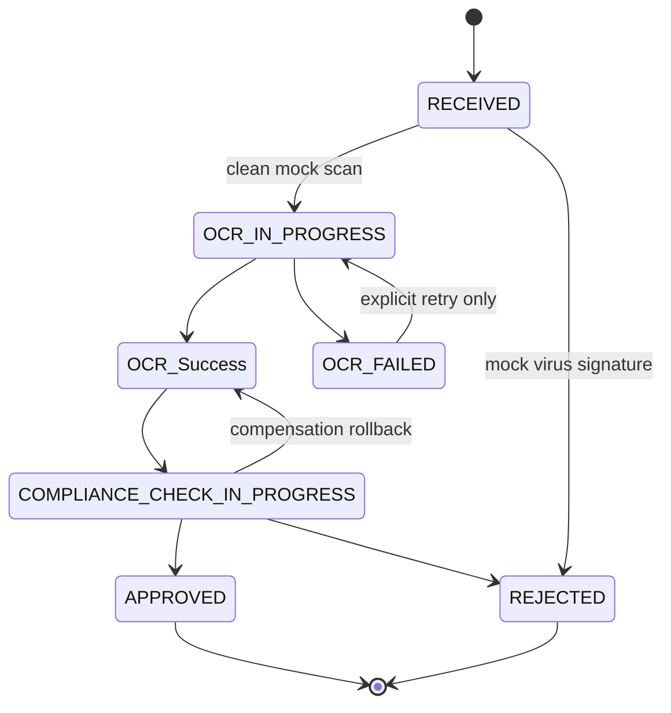
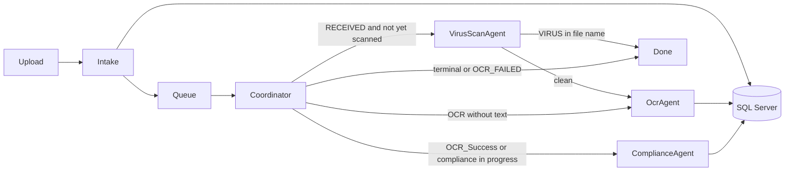
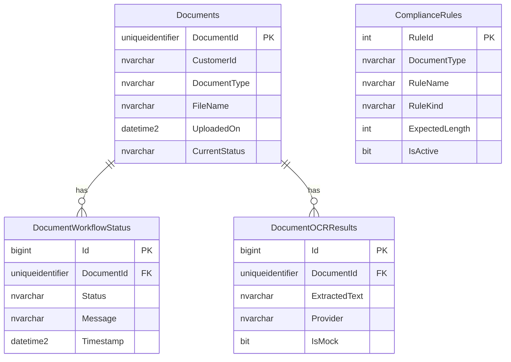

# Document Processing Orchestration System

Enterprise-style workflow for compliance documents (PAN, AADHAR, LOA). The API accepts a document, stores it, and a coordinator routes it through OCR and sample compliance checks. State, audit history, and recovery live in SQL Server.

The OCR step reads text from the submitted file and can simulate timeouts and failures. On Windows, an image is read with the Windows OCR engine. A text file must contain the PAN, AADHAR, or LOA value. If that value is missing or fails a SQL length rule, the document is rejected and the remarks explain why.

Passing a length rule does **not** establish that a document is authentic.

## Prerequisites

| Tool | Version used |
| --- | --- |
| .NET SDK | 8.0.100 |
| SQL Server LocalDB | 2019 (`MSSQLLocalDB`) |
| sqlcmd | ODBC 17 tools |

Microsoft Agent Framework package `Microsoft.Agents.AI.Workflows` **1.25.0** targets `net8.0`. No prerelease packages are used.

## Package list

### NuGet

| Package | Version | Why |
| --- | --- | --- |
| Microsoft.Agents.AI.Workflows | 1.25.0 | Workflow builder, executors, conditional edges, in-process execution. Pulls in Microsoft.Agents.AI. |
| Microsoft.Data.SqlClient | 6.0.2 | Free SQL Server driver. |
| Swashbuckle.AspNetCore | 6.9.0 | Swagger UI. MIT license. |
| Microsoft.AspNetCore.OpenApi | 8.0.0 | OpenAPI metadata for the .NET 8 web SDK. |
| Microsoft.Extensions.DependencyInjection.Abstractions | 8.0.2 | DI abstractions. |
| Microsoft.Extensions.Logging.Abstractions | 8.0.2 | Structured logging. |
| Microsoft.Extensions.Options.ConfigurationExtensions | 8.0.0 | Options binding. |
| xunit / Microsoft.NET.Test.Sdk | SDK template | Unit tests. |
| Microsoft.AspNetCore.Mvc.Testing | 8.0.0 | API integration host. |

Entity Framework Core is not used. Mandatory writes go through stored procedures.

`Microsoft.Agents.AI.OpenAI` is **not** installed. Basic validation does not need a model or an API key.

## Database setup

```powershell
sqllocaldb start MSSQLLocalDB
sqlcmd -S "(localdb)\MSSQLLocalDB" -b -i database\001_CreateDatabase.sql
```

The script creates database `DocumentProcessing`, tables, `dbo.fn_WorkflowTransitionAllowed`, and stored procedures:

- `sp_UpdateWorkflowStatus`
- `sp_SaveOCRText`
- `sp_GetComplianceRules`

It seeds sample rules for PAN (exact length 10), AADHAR (exact length 12), and LOA (minimum reference length 6). Re-running the script does not drop existing tables.

`DocumentOCRResults` stores extracted text. The mandatory `Documents` table has no OCR column, so OCR text is not forced into that table.

Operational columns `StoragePath`, `LockToken`, and `LockedUntil` on `Documents`, plus agent/tool/attempt columns on `DocumentWorkflowStatus`, support file location, single-worker locks, and audit. They are in addition to the required columns.

### Connection string

`src/DocumentProcessing.mvc/appsettings.json` uses Windows integrated security and no password:

```text
Server=(localdb)\MSSQLLocalDB;Database=DocumentProcessing;Integrated Security=True;TrustServerCertificate=True;Encrypt=False
```

Override it with the `ConnectionStrings:DocumentProcessing` setting or an environment variable `ConnectionStrings__DocumentProcessing`. Do not commit passwords. `appsettings.Example.json` shows the same shape.

## Run the API

```powershell
dotnet run --project src/DocumentProcessing.mvc/DocumentProcessing.mvc.csproj --launch-profile http
```

The API listens on `http://localhost:5280`. Swagger is at `http://localhost:5280/swagger`. Health is `GET /health`. Port 5080 is reserved by Windows on this machine, so the local profile uses 5280.

Uploaded files are stored under the API content root in `App_Data/documents/{documentId}/`. That folder is gitignored.

## Open the MVC UI

Start the API with the command above, or press F5 in Visual Studio on the `http` profile. The pages are served by the same process:

- Dashboard: `http://localhost:5280/dashboard`
- Upload: `http://localhost:5280/upload`
- Documents: `http://localhost:5280/documents`
- Rules: `http://localhost:5280/compliance-rules`
- Swagger stays at `http://localhost:5280/swagger` for Postman-style API checks.

The UI is ASP.NET Core MVC. It calls the same intake agent, workflow, and SQL tools as `/api/documents`.

Screenshots of Swagger, the dashboard, and the SQL audit history are in `docs/screenshots`.

## API

| Method | Path | Purpose |
| --- | --- | --- |
| POST | `/api/documents/upload` | Accept metadata and Base64 content. Returns `202` and `documentId`. |
| GET | `/api/documents/{id}/status` | Current status and timestamps. |
| GET | `/api/documents/status/{id}` | Same status response. This is the path named in the task document. |
| GET | `/api/documents` | Paged list. Query: `page`, `pageSize`, `status`, `documentType`, `search`. |
| GET | `/api/documents/{id}` | Metadata, mock OCR text, compliance remarks. |
| GET | `/api/documents/{id}/history` | Audit events, oldest first. |
| POST | `/api/documents/{id}/retry` | Explicit retry or resume for a non-terminal workflow. |
| GET | `/api/documents/summary` | Dashboard counts. |
| GET | `/api/documents/activity?take=8` | Recent audit rows. |
| GET | `/api/compliance-rules` | Active rules. |

List and status responses do not include file bytes or Base64. OCR text is returned only from the detail endpoint, with `isMock: true` for the mock provider.

Validation failures are `400`. Missing documents are `404`. Illegal retry or a busy lock is `409`.

### Sample upload

```http
POST /api/documents/upload
Content-Type: application/json

{
  "customerId": "CUST-1001",
  "documentType": "PAN",
  "fileName": "sample-pan.txt",
  "fileContentBase64": "c2FtcGxl"
}
```

File names can drive the mock:

| Token | Behavior |
| --- | --- |
| `__failonce` | First OCR attempt fails, the next succeeds. |
| `__timeout` | Every OCR attempt exceeds the tool timeout. |
| `__permanent` | OCR fails immediately and is not retried. |
| `__interrupt` | OCR succeeds, then the workflow stops before compliance. The next run continues at compliance. |
| name contains `VIRUS` | Mock scan rejects the document after it is stored as `RECEIVED`. Status becomes `REJECTED` and OCR does not run. |

A Postman collection is in `postman/DocumentProcessing.postman_collection.json`.

## Agents and tools

| Piece | Role |
| --- | --- |
| `DocumentIntakeAgent` | Validates PAN, AADHAR, or LOA metadata, saves the file, calls `SqlTool.SaveDocumentMetadataAsync`, sets `RECEIVED`, and hands the id to the coordinator queue. |
| `VirusScanAgent` | Runs after `RECEIVED`. A clean mock scan writes a same-status audit and continues to OCR. A file whose name contains `VIRUS` moves to `REJECTED` and skips OCR. |
| `OcrAgent` | Sets `OCR_IN_PROGRESS`, reads the file, calls `OcrTool.ExtractTextAsync`, saves text with `SqlTool.SaveExtractedTextAsync`, then sets `OCR_Success` or `OCR_FAILED`. |
| `ComplianceAgent` | Refuses to run unless status is `OCR_Success` or `COMPLIANCE_CHECK_IN_PROGRESS`. Loads rules with `ComplianceRulesTool.GetRulesAsync`, checks text with `ComplianceRulesTool.ValidateTextAsync`, then sets `APPROVED` or `REJECTED`. |
| `CoordinatorAgent` | Reads persisted status and chooses the next route. |

`SqlTool.SaveDocumentMetadataAsync` calls `sp_SaveDocument` and then `sp_UpdateWorkflowStatus` in one transaction. `SqlTool.SaveExtractedTextAsync` calls `sp_SaveOCRText`. `ComplianceRulesTool.GetRulesAsync` calls `sp_GetComplianceRules` through `SqlTool` and keeps the result in an application memory cache for 60 seconds. Status changes and the audit insert commit in the same stored-procedure transaction.

Identifier extraction is deterministic C# (`DocumentIdentifierExtractor`): PAN `\b[A-Z]{5}[0-9]{4}[A-Z]\b`, AADHAR 12 digits, LOA `LOA-` reference. No model is used.

### VirusScanAgent

`VirusScanAgent` is a workflow executor between intake and OCR. `MockVirusScanTool` checks the file name for `VIRUS`. It is not a real antivirus engine. A failed scan is stored as `REJECTED` because the status list has no separate virus-failure value. A passed scan stays on `RECEIVED` and is not repeated when that audit row already exists.

### Agent Framework boundary

`DocumentWorkflowService` builds a real Microsoft Agent Framework workflow:

- `WorkflowBuilder`
- `Executor<WorkflowMessage, WorkflowMessage>`
- conditional `AddEdge`
- `InProcessExecution.RunAsync`

Those types come from `Microsoft.Agents.AI.Workflows` 1.25.0. The domain agents are application services inside those executors. Handoff and group-chat builders require an `AIAgent` chat client, so they are not used for length checks. Retries, SQL locks, compensation, and restart recovery are application code. They are not built-in framework features. Framework in-memory checkpoints are not a substitute for the SQL audit trail.

## Workflow



Same-status updates are allowed so attempt and compensation audits can be appended without changing the current status.



Recovery does not restart every step:

- `RECEIVED`: run the virus scan, then OCR when the scan is clean. A previous passed-scan audit skips the scan.
- `OCR_IN_PROGRESS` with no OCR row: resume OCR and keep the previous attempt count.
- `OCR_IN_PROGRESS` with OCR text already stored: repair the status to `OCR_Success` and run compliance only.
- `OCR_Success`: run compliance only.
- `COMPLIANCE_CHECK_IN_PROGRESS`: run compliance again. It is safe to repeat.
- `OCR_FAILED`: wait for `POST /retry`. Automatic recovery does not pick it up.
- `APPROVED` / `REJECTED`: skip. A second run returns `AlreadyComplete`.

A SQL lock (`LockToken`, `LockedUntil`) stops two workers from processing the same document. If the process stops, the lock expires and the recovery worker reads unfinished rows from SQL. The in-memory channel is only a fast path.

## Retry, timeout, and compensation

`appsettings.json`:

| Setting | Default |
| --- | --- |
| `Workflow:MaxRetryAttempts` | 3 total attempts |
| `Workflow:ToolTimeoutMilliseconds` | 30000 |
| `Workflow:OcrDelayMinMilliseconds` / `Max` | 1000 / 3000 |
| `Workflow:LockLeaseSeconds` | 180 |
| `Workflow:RecoveryPollSeconds` | 15 |

`OcrTimeoutException` and `TransientToolException` are retried. `PermanentToolException` is not. Caller cancellation is not treated as a retry.

Permanent OCR failure sets `OCR_FAILED` and writes: `Compensation: OCR failed permanently...`. The file, metadata, and history stay. Compliance is not started.

Permanent compliance failure rolls the status back to `OCR_Success` and writes a compensation audit. Automatic recovery skips that case so a permanent tool failure does not loop. `POST /retry` can run it again.

An `__interrupt` file stops after `OCR_Success`. Replay sees the interrupt audit and continues at compliance without a second OCR call.

## Logging

`ILogger` scopes include correlation id, document id, agent, tool, and attempt. Transitions log duration and exception type. File bytes, Base64, and connection strings are not logged. The response header `X-Correlation-Id` echoes the request id.

## Tests

```powershell
dotnet test tests/DocumentProcessing.Tests/DocumentProcessing.Tests.csproj
```

Backend tests cover transitions, each agent path, rule failure, missing documents, timeout, retry success, permanent failure, compensation, audit history, routing, replay, and duplicate locks. `ApiIntegrationTests` uses LocalDB and is included in `dotnet test`.

## ER diagram



## Known limitations

- Text files are decoded directly. On Windows, images are read with `Windows.Media.Ocr`. Other systems still need a text file.
- Sample length rules are not identity verification.
- There is no durable external queue. Recovery polls SQL.
- Compliance rule editing is not implemented. The rules page only displays SQL data.
- The UI is ASP.NET Core MVC in the API project.
- OpenTelemetry writes traces to the console. Each agent activity carries `document.id`, `correlation.id`, `agent.name`, and `tool.name`. Duration is the activity duration. This is application tracing, not an Agent Framework feature.
- Compliance rules use `IMemoryCache` for 60 seconds. The Agent Framework package has no public agent-hints API, so this cache is application code.
- Docker Compose is in `docker-compose.yml`. Copy `.env.example` to `.env` and set `MSSQL_SA_PASSWORD` before `docker compose up --build`. The API is published on host port 5280. Do not commit `.env`.
